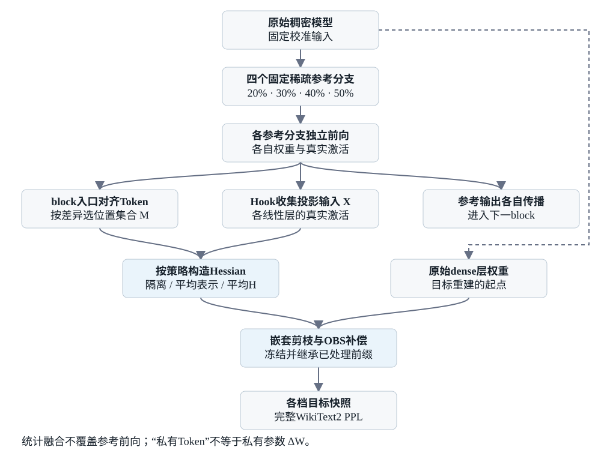
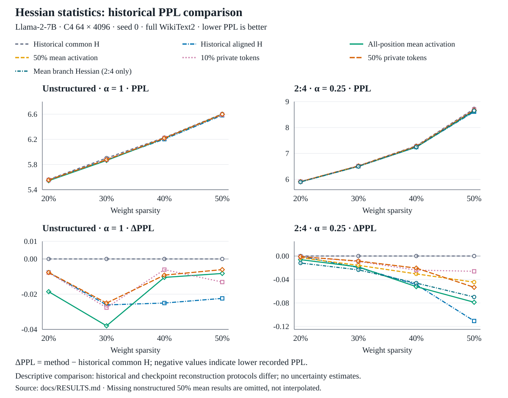

# Elastic Nested Hessian Pruning

**研究不同稀疏率的激活统计，如何帮助嵌套剪枝进行误差补偿。**

本项目基于 Wanda / SparseGPT，在同一组校准 Token 上运行20%、30%、40%、50%四个稀疏参考分支，对比 Token 隔离、平均表示和平均 Hessian。目标是研究保留嵌套数值共享时，如何利用不同分支的信息改善补偿。

项目还保留了另一条研究线：**通过列排序或宏块内四列组排序，改变嵌套剪枝的处理顺序与分组，再进行OBS补偿。** 两条研究线分别回答“先处理哪些权重”和“用哪些激活统计补偿”；当前Hessian/Token对照不额外排序。

当前提供研究实现、数值测试和历史PPL记录，主要支持标准 Llama 七个线性投影。项目尚处于实验阶段，尚未提供最终的单文件弹性模型存储与部署接口。

[同门接手指南](docs/GETTING_STARTED.md) · [方法原理](docs/METHOD.md) · [安装与数据](INSTALL.md) · [实验复现](docs/EXPERIMENTS.md) · [结果记录](docs/RESULTS.md) · [代码导航](docs/CODE_MAP.md)

第一次接手：按[接手指南](docs/GETTING_STARTED.md)完成环境准备、测试和小规模运行。已有验证及其覆盖范围见[验证记录](docs/VALIDATION.md)。

## 我们在研究什么

独立剪枝时，每个稀疏率都可以用自己的激活统计进行重建；嵌套剪枝还需要继承已处理的权重前缀，因此不同分支的信息会影响同一条重建轨迹。

本项目先生成四个固定稀疏参考分支，再使用它们的真实线性层输入构造重建统计：相近位置可以复用20%锚点，差异位置可以保留分支激活，也可以对分支激活求平均。随后从原始稠密层权重开始，分阶段执行 SparseGPT 补偿。

Token 隔离中的“私有”指部分校准位置使用各分支自己的激活统计。实际参考前向始终各自传播；没有另外拟合每率的参数残差 ΔW。完整数据流与公式见 [METHOD.md](docs/METHOD.md)。



图中蓝色模块是统计构造与目标补偿；右侧参考输出仍各自进入下一block。融合只改变H的统计，不替换参考分支真实前向。

## 快速开始

下载仓库或发布源码包，在项目根目录执行。需要 Linux + NVIDIA GPU、本地 Hugging Face Llama 模型，以及 `datasets.save_to_disk` 格式的 C4 / WikiText2。数据集路径设置见 [INSTALL.md](INSTALL.md)。

```bash
git clone https://github.com/lovewaram-source/elastic-nested-hessian-pruning.git
cd elastic-nested-hessian-pruning
python -m pip install -r requirements.txt
python -m unittest discover -s tests -p 'test_*.py'

# 查看实验入口和参数
python scripts/run_checkpoint_token_isolation.py --help

# 正式实验：10% Token 隔离；一张卡；完整 WikiText2 PPL
python scripts/run_checkpoint_token_isolation.py \
  --model /path/to/Llama-2-7b-hf \
  --mode 2of4 --gpu 0 --device-map cpu \
  --nsamples 64 --seqlen 4096 --seed 0 \
  --rates 0.2,0.3,0.4,0.5 \
  --selection-rule cosine --shared-fusion anchor20 --private-fraction 0.1 \
  --structured-alpha 0.25 \
  --output results/private10-2of4 --cache cache/private10-2of4
```

`--mode unstructured --unstructured-alpha 1` 可运行非结构化对照。每次使用新的输出、缓存目录。希望先确认数据流时，可按[小规模检查配方](docs/EXPERIMENTS.md#第一次运行先做小规模检查)缩小校准和评测预算；正式PPL必须恢复完整设置。

主入口使用单GPU、CPU逐层调度，最终PPL阶段会把完整目标模型放到该GPU。当前没有统一测定所有环境下的最低显存、内存和时间预算；缓存建议放在有足够空间的本地SSD。已测试环境与安装限制见 [INSTALL.md](INSTALL.md)。

## 排序：先处理哪些权重，怎样组成四列组

SparseGPT按列依次剪枝，并将误差补偿到尚未处理的权重。因此，排序不仅改变处理先后；若重新组合四列组，还会改变哪些权重在同一个2:4组内竞争。我们研究的是这些变化能否改善嵌套剪枝，而不是把排序本身当成额外补偿。

### 宏块内四列组排序

2:4实验把输入列划为40%/20%/20%/20%四个固定宏块，依次在对应宏块开启2:4剪枝，形成20%、30%、40%、50%的全局稀疏率。**宏块内排序不跨宏块移动权重，不改变这四档的剪枝预算。**

| 策略 | 如何评分与排列 | 是否改变四列组成员 |
|---|---|---|
| 整组Wanda降序 | 累加四列全部权重的Wanda分数，宏块内高分组先处理 | 否，完整四列组一起移动 |
| 预测剪掉部分Wanda降序 | 每行每四列先按Wanda预测剪掉两个，只累加这些位置的分数，再在宏块内高分组先处理 | 否，完整四列组一起移动 |
| P&P式四分位交错 | 宏块内先按单列Wanda分数降序，分成四个等长区间；各区间取同一排名位置，组成一个新四列组 | 是，让不同敏感度区间的列进入同一组 |

其中，“预测剪掉部分”的出发点是：整组总分包含最终可能保留的权重，而预测删除位置的分数更直接描述该组潜在的剪枝代价。它是否更有效需要实验比较，不能仅从评分定义推出。

具体地，Wanda元素分数为 $A_{ij}=|W_{ij}|a_j$，默认 $a_j=\sqrt{H_{jj}}$，在加阻尼前提取。对四列组 $g$，令 $P_g$ 标记每行分数最小的两个位置，则预测剪掉部分的组分数为：

$$
C_g=\sum_i\sum_{j\in g} A_{ij}(P_g)_{ij}.
$$

内核选项 `wanda_group_pruned_part_stage_desc` 就是在每个宏块内按 $C_g$ 降序排列。这里的Wanda预测掩码**只用于排序评分**，不等于后续重建时实际采用的SparseGPT掩码。

### 单列排序与补偿如何衔接

非结构化内核还保留了按全列Wanda或SparseGPT敏感度求和排序，以及先预测全局剪枝掩码、再按各列预测删除部分评分的变体。**这些普通单列选项在当前代码中是低分在前，不能与上面的宏块内高分组在前混淆。**

确定排列后，权重列与逆Hessian的两轴使用同一排列，并重新计算所需的分解因子；剪枝和OBS在这个坐标系中进行，最后通过逆排列恢复原坐标。静态排序通常在准备计划时计算一次；另有按更新后权重重排下一宏块的动态整组Wanda函数，不是每四列重新排序一次。

### 代码与当前实验边界

已保留内核位于 `lib/elastic_sparsegpt.py`：`column_permutation()` 选择排序策略，`_wanda_group_stage_desc_order()` 实现宏块内整组排序，`_wanda_group_stage_quartile_interleave_order()` 实现P&P式交错。

现在提供独立排序入口 `scripts/run_sorting_nested.py`：固定稠密参考H，依次重建20%/30%/40%/50%目标，并保存实际排列。**原Hessian/Token主入口仍使用原始列顺序，不受这个入口影响。** 旧历史CLI仍归档；新入口不代表历史PPL已复现。当前没有RIA排序选项。

```bash
# 先用短评测检查流水线；这是调试PPL，不与正式结果表混用。
python scripts/run_sorting_nested.py \
  --model /path/to/Llama-2-7b-hf --mode 2of4 --gpu 0 \
  --ordering wanda_group_pruned_part_stage_desc --structured-alpha 0.25 \
  --nsamples 2 --seqlen 128 --eval-samples 2 \
  --output results/smoke-sorting --cache cache/smoke-sorting
```

使用新的output/cache目录，另跑 `--ordering original` 作为同流水线对照；非结构化可用 `--mode unstructured --ordering wanda --unstructured-alpha 1`。正式对照恢复相同的64×4096校准并去掉`--eval-samples`。下面的Hessian PPL表不包含排序收益，详细配方和边界见[排序代码说明](docs/SORTING.md)。

## 方法与入口

| 研究内容 | 入口 |
|---|---|
| 当前 Token 隔离、平均激活、平均 H、替换误差门槛 | `scripts/run_checkpoint_token_isolation.py` |
| 共用 dense-reference H 与各率完整对齐 H 的历史对照 | `scripts/run_rate_aligned_nested.py` |
| 按模块选择 Token 的诊断和消融 | 同一 checkpoint 入口的 `module_*` 选项 |
| 补偿冲突诊断（不生成 PPL） | `scripts/run_compensation_conflict.py` |
| 独立排序对照：固定dense H，无Token融合 | `scripts/run_sorting_nested.py` |
| 嵌套剪枝与 OBS 内核 | `lib/elastic_sparsegpt.py`、`lib/sparsegpt.py` |

Token 隔离中的“私有”指部分校准位置使用各稀疏率自己的激活统计；剩余位置使用 20% 锚点。全平均指同一位置的各分支激活先平均再计算 Gram。平均 H 则是各分支 Gram 等权平均，两者不同。实际前向仍按固定参考分支各自传播。

## 核心对照

以下为 Llama-2-7B、C4 64×4096、seed=0、完整 WikiText2 的2:4实验记录，补偿系数α=0.25，PPL越低越好。

| 方法 | PPL@20% | PPL@30% | PPL@40% | PPL@50% |
|---|---:|---:|---:|---:|
| 历史 common dense-reference H † | 5.9105 | 6.5234 | 7.2951 | 8.7218 |
| 历史各率完整对齐 H † | 5.9098 | 6.5038 | 7.2465 | 8.6111 |
| 全部平均表示→H | 5.9043 | 6.5049 | 7.2429 | 8.6430 |
| 50%位置平均表示→H | 5.9077 | 6.5075 | 7.2646 | 8.6773 |
| 10% Token私有 | 5.9095 | 6.5142 | 7.2711 | 8.6958 |
| 50% Token私有 | 5.9095 | 6.5148 | 7.2745 | 8.6685 |

† 历史对照与当前候选方法的重建执行策略不同，属于描述性比较。各率完整对齐H不是理论PPL下界。20%至50%表示全局稀疏率，中间档位仍包含未剪枝的稠密宏块。非结构化结果、平均H结果和完整来源见 [RESULTS.md](docs/RESULTS.md)。



上排展示绝对PPL，下排展示相对历史common H的差值，以便看清小幅变化。两列使用不同纵轴范围；缺失结果不绘制，没有多seed误差条。这是历史记录的描述性比较，不是严格配对收益或显著性检验。

两图保留可编辑SVG；结果图直接读取[完整数值表](docs/RESULTS.md)。修改数据后运行 `python scripts/plot_readme_figures.py` 重新生成，无需额外绘图库。

## 目录

```text
lib/                 4个必要内核：剪枝、补偿、N:M掩码和数据加载
scripts/             实验入口、Hessian 构造、诊断与汇总
tests/               数值等价、实际分支前向、掩码与预算等测试
docs/CODE_MAP.md     阅读顺序、关键依赖和修改位置
docs/METHOD.md       符号、方法公式与参考/目标数据流
docs/EXPERIMENTS.md  各方法的参数组合、运行与结果检查
docs/RESULTS.md      已核对的 PPL 对照与来源说明
```

新接手代码时，先读主入口 `run_checkpoint_token_isolation.py` 和统计核心 `checkpoint_token_isolation_core.py`。各类修改应放在哪里、测试覆盖哪些约束，见 [CODE_MAP.md](docs/CODE_MAP.md)。源码打包流程见[维护者发布说明](docs/RELEASING.md)。

## 继续实验

先运行小模型测试，再使用新目录做 GPU 小规模检查，最后运行统一校准与完整 PPL 对照。保留每次运行的 `protocol.json`、`comparison.tsv`、`results.json` 和计时文件。2026-10-21在Linux / RTX 4090上通过全部67项测试，包含独立排序的CUDA端到端检查；本轮未重跑7B PPL，详见[验证记录](docs/VALIDATION.md)。接手者仍应在自己的环境验证。

当前checkpoint主入口没有断点续跑或永久模型导出功能，评测成功后会清理已消费的目标快照。源码和临时评测缓存的用途见[实验说明](docs/EXPERIMENTS.md)。贡献规则和下一轮对照建议见 [CONTRIBUTING.md](CONTRIBUTING.md)。

## 来源与许可

本项目基于 [Wanda](https://github.com/locuslab/wanda) 和 [SparseGPT](https://github.com/IST-DASLab/sparsegpt)，保留原 [MIT LICENSE](LICENSE) 与版权声明。它是研究扩展代码，不是 Wanda、SparseGPT 或其他引用方法的官方新版本。
