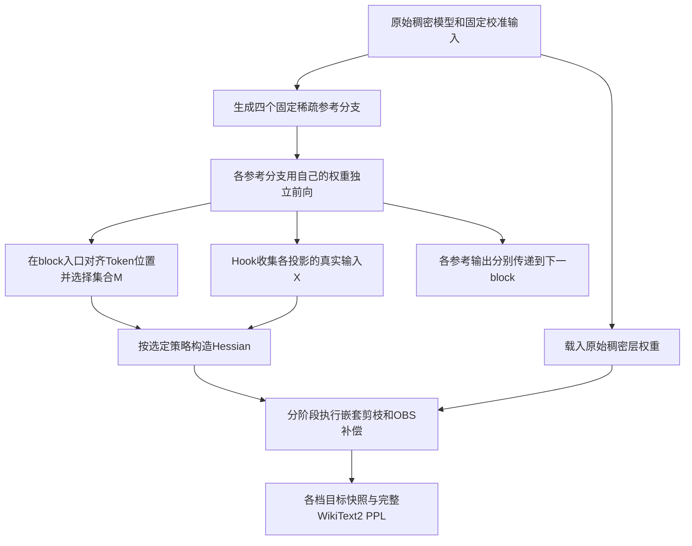

# 方法说明：Token统计如何进入嵌套补偿

本页描述当前 `run_checkpoint_token_isolation.py` 的实际实现。它比较不同Hessian构造方式对嵌套剪枝的影响；历史的各率完整对齐replay是另一种执行策略，单独在后文说明。

## 1. 问题与符号

对于一个线性层，权重和输入分别为：

$$
W\in\mathbb{R}^{d_{out}\times d_{in}},\qquad X_r\in\mathbb{R}^{d_{in}\times T},\qquad Y_r=WX_r.
$$

在这个数学约定里，**X的一列是一个Token位置的完整隐藏向量**；W的一行对应一个输出通道，W的一列对应一个输入特征。代码Hook拿到的张量为`[校准样本数, 序列长度, 输入维度]`，累计Gram时会展平Token位置并转置。

| 符号 | 含义 |
|---|---|
| r | 权重稀疏率，默认20%、30%、40%、50% |
| a=20% | 激活比较与复用的锚点分支 |
| q | 要隔离或平均的Token位置比例，与权重稀疏率r不同 |
| B、L、T | 校准序列数、序列长度、Token总位置数；T=B×L |
| Z_r | 参考分支在Transformer block入口的隐藏表示，用于选位置 |
| X_r | 参考分支在某个实际线性投影入口的激活，用于构造H |
| M_q | 当前block选中的Token位置集合，所有投影共用 |
| α | 补偿更新的缩放系数；本实验非结构化为1、2:4为0.25 |

本实现的统计归一化可写为：

$$
G(X)=\frac{2}{B}XX^\top.
$$

B是原校准序列数。隔离子集仍用同一个B归一化，不按各自Token数量重新归一化。该约定与代码按序列累计Hessian的方式一致。

## 2. 参考分支与重建目标

参考分支负责提供激活，重建目标负责产生待评测的剪枝权重。两者角色不同。

四个参考分支由普通common dense-reference H嵌套基线生成。收集当前层时，每个分支显式使用自己的参考权重和真实上游激活，分别执行前向。融合后的激活只用于H统计，不覆盖真实参考前向路径。

目标层重建从原始dense层权重开始，然后按稀疏率阶段使用不同H。目标重建得到的输出也不会反过来更新本次固定参考路径，因此这不是反复求解自洽激活的迭代算法。

## 3. 如何选择差异Token

以同一个校准样本、同一个序列位置的block入口向量为单位，比较其他稀疏率与20%锚点的余弦距离：

$$
d_t=\max_{r\ne a}\left(1-\frac{z_{r,t}^{\top}z_{a,t}}{\|z_{r,t}\|_2\|z_{a,t}\|_2}\right).
$$

实际代码使用带eps的余弦相似度。在当前block的全部B×L个位置中稳定降序排序，选出：

$$
|M_q|=\lceil qBL\rceil.
$$

平局按原位置顺序处理。一层只选一套位置，四个分支和该层所有投影共用；选位置使用Z，计算每个投影的H使用该投影的真实输入X。

第一层入口是相同的embedding，四路入口表示没有差异信号，位置由平局规则决定。Token位置不会被从实际模型前向中删除；这里是在选择统计采用哪一路激活。

## 4. 对照方法如何构造H

### Token隔离：10%或50%私有

未隔离位置使用锚点，隔离位置使用各分支自己的激活：

$$
H_r=G(X_{a,\overline{M_q}})+G(X_{r,M_q}).
$$

共享部分只累计一次，再加各分支私有统计。q=0.1和q=0.5分别是表中的10%私有和50%私有。“私有”指H的激活贡献按分支区分，代码没有额外学习独立参数残差ΔW_r。

在同一pipeline中，q=0是全部采用真实20%锚点输入的控制，q=1是全部采用各固定参考分支输入的控制。后者仍遵守同一条嵌套目标重建轨迹，不等同于历史完整对齐replay。

### 全部平均表示，再计算H

同一Token位置在各参考分支之间做算术平均：

$$
\bar X=\frac{1}{|R|}\sum_{r\in R}X_r,\qquad H_{mean\text{-}act}=G(\bar X).
$$

所有位置都平均，不做余弦筛选，所有目标阶段共用这个H。

### 50%位置平均，其余位置使用锚点

选出余弦差异最大的50%位置，在选中位置平均四路激活：

$$
H_{half\text{-}mean}=G(X_{a,\overline{M_{0.5}}})+G(\bar X_{M_{0.5}}).
$$

所有目标阶段共用同一个H。这与“50%私有”不同：前者在选中位置合并分支，后者保留各分支自己的统计。

### 各分支Hessian平均

$$
H_{mean\text{-}H}=\frac{1}{|R|}\sum_{r\in R}G(X_r).
$$

这与先平均激活不同。令 $E_r=X_r-\bar X$，则：

$$
H_{mean\text{-}H}-H_{mean\text{-}act}=\frac{2}{B|R|}\sum_{r\in R}E_rE_r^\top.
$$

平均H保留分支差异的二阶统计；这个恒等式不意味着其PPL一定更低，需要通过实验判断。

### 替换误差门槛

在block入口计算：

$$
e_t=\max_{r\ne a}\frac{\|z_{r,t}-z_{a,t}\|_2}{\max(\|z_{r,t}\|_2,\epsilon)}.
$$

有效位置中，e_t≤门槛的位置使用锚点；其他位置平均各分支激活，再构造一个共用H。5%和10%是误差门槛，选中的Token比例由数据决定，不是预先固定5%或10%的位置。

## 5. H如何进入补偿

H先经过dead-column处理与对角阻尼，再分解成SparseGPT使用的逆Hessian因子。`percdamp`决定阻尼大小；α决定补偿更新的缩放，两者作用不同。

以2:4实验为例，依次开启40%、20%、20%、20%的输入列宏块；在已开启区域做2:4剪枝，产生20%、30%、40%、50%的全局零权重比例。分阶段补偿使用对应H20、H30、H40、H50，已经处理的数值前缀冻结并继承，误差向尚可更新的区域传播。

非结构化保留内部辅助10%切片；内部10%和20%阶段都使用H20，后续阶段依次使用对应H。当前checkpoint实验不进行额外列排序。

α=0.25表示对误差传播更新进行缩放，不代表只保留25%的Token，也不改变稀疏掩码预算。本实现仍是SparseGPT式逐步更新，没有实现对所有稀疏率的联合损失做全局闭式求解。

冻结前缀等数值共享约束已在测试中检查。当前运行使用临时各率层快照进行PPL评测，尚未提供可直接部署的一套弹性权重文件和加载器。

## 6. 历史对照应如何理解

| 对照 | H来自哪里 | 权重如何重建 |
|---|---|---|
| 历史common dense-reference H | 稠密参考校准统计 | 复用同一套准备统计逐阶段剪枝 |
| 历史各率完整对齐H | 每个目标率自己的逐层分支激活 | 每个目标率从dense重新重放继承掩码 |
| 当前Token隔离/平均方法 | 固定稀疏参考分支的激活及其融合统计 | 每层从dense建立单条分阶段目标轨迹，冻结数值前缀 |

历史common dense-H与“当前全部用真实20%锚点激活”不是相同统计。历史完整对齐H也不是理论最优PPL下界。结果表的差值只能作为现有记录的描述性对照；下一步应在同一重建策略下重跑控制组和候选方法。

下一页：[运行这些方法](EXPERIMENTS.md) · [查看源码位置](CODE_MAP.md) · [查看PPL记录](RESULTS.md)
